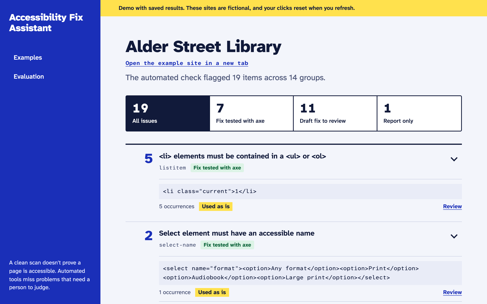
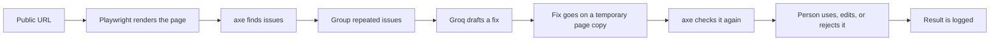

# Accessibility Fix Assistant

A full-stack tool that scans a web page for accessibility problems, explains them in plain English, drafts HTML fixes, and tests those fixes before a person decides what to do with them.

**[Try the live demo](https://YOUR-VERCEL-URL)** (no account or API key needed)



## Why I built this

I maintain a large set of web pages at my job, and accessibility fixes are a regular part of the work. A scanner can tell me what's wrong, but I still have to work out what it means, find the right HTML, write the fix, and check that it worked. I built this to speed up that middle part while keeping a person in charge of the result.

Nothing here edits a live site. The tool gives you a fix to review and copy.

## How it works



Each issue gets one of three levels, so the app is upfront about what it can do:

| Level | What happens |
| --- | --- |
| Fix tested with axe | Gets a suggested fix, and axe can check whether the fix worked |
| Draft fix to review | Gets a suggested fix, but it needs a person's judgment, like alt text or a color choice |
| Report only | Gets a tip on what to check, with no code fix yet |

## What's interesting about it

**A passing test isn't treated as a correct fix.** Early on, the model fixed a broken link by deleting the link. axe's count improved because there was nothing left to flag. The validator now rejects any fix that removes the element it was meant to repair, and every suggestion still goes to a person.

**Some decisions don't go to the model at all.** Passing colors are calculated with the WCAG contrast formula. Code also flags vague labels like "Select option," labels that only repeat a field's code name, and rules that always need human judgment, even when the model sounds confident.

**Repeated issues are grouped by likely cause.** On the demo library page, one bad `role` on a list makes axe flag all five pagination items. The app shows that as one fix, and the test result shows the count going from 5 to 0.

**The review flow keeps going after a bad suggestion.** You can reject a fix and send your reason back to the model for up to three attempts, or edit the HTML and run it through the same test. Rejected attempts stay in the evaluation numbers.

**An accessibility tool should pass its own check.** CI runs axe on the built app in a real browser at desktop and phone widths, including color contrast.

## Evaluation

I ran the pipeline on three fictional sites with planted problems and reviewed all 40 suggestions. For each one, I recorded whether I'd use it as is, edit it, or reject it.

| Rule | Fixes | Used as is | Edited | Rejected |
| --- | ---: | ---: | ---: | ---: |
| `image-alt` | 11 | 9 | 1 | 1 |
| `color-contrast` | 9 | 8 | 1 | 0 |
| `link-name` | 8 | 6 | 2 | 0 |
| `label` | 3 | 1 | 2 | 0 |
| `select-name` | 3 | 3 | 0 | 0 |
| `button-name` | 2 | 1 | 1 | 0 |
| `html-has-lang` | 2 | 2 | 0 | 0 |
| `frame-title` | 1 | 0 | 1 | 0 |
| `listitem` | 1 | 1 | 0 | 0 |
| **Total** | **40** | **31** | **8** | **1** |

Every fix lowered axe's count for its rule on a temporary page copy and added no new violations.

**Please read these numbers as a small benchmark, not as real-world accuracy:**

- I built the pages and planted the problems, and I tuned some rule hints while building the tool. The pagination hint, for example, describes that exact mistake.
- An AI assistant recommended answers during the review. I made the final call on each one, but this wasn't a blind or independent review.
- Forty suggestions is a small sample, and the same problem appears more than once. An image alone inside a link is flagged by both `image-alt` and `link-name`.

The edits were the most useful result. axe accepts an `aria-label`, but sighted users still see an empty field, so I replaced those with visible labels.

## Limitations

- axe can't detect every accessibility problem, so a clean scan doesn't mean a page is accessible.
- The model can't see images. It works from file names and nearby text, so a person has to check its alt text.
- Tests run on the rendered page, which can differ from what you edit in a CMS. Fixes for JavaScript components may belong in the component's code.
- axe shortens very long attributes. When that happens, the app warns you to add only the new attribute to your real tag.
- Scan history is separated by a random browser ID, not a login. Don't use it to protect private data.

## The live demo

The public site is a static build with saved results from the real pipeline. It makes no Groq calls, doesn't scan live URLs, and doesn't save your clicks. Public scanning would need a hosted browser, rate limits, and a spending limit on the API, so for now it only runs locally.

## Run it locally

You'll need Python 3.13 or newer, Node 22 or newer, and a [Groq API key](https://console.groq.com/keys).

```bash
# backend
python3 -m venv .venv
source .venv/bin/activate
pip install -r requirements.txt
playwright install chromium
cp .env.example .env    # then add your GROQ_API_KEY
uvicorn app.main:app --reload
```

```bash
# frontend, in a second terminal
cd frontend
npm ci
npm run dev
```

Open `http://localhost:5173`.

To regenerate the evaluation:

```bash
PYTHONPATH=. python scripts/generate_demo_data.py --fresh
PYTHONPATH=. python scripts/review_demo_data.py
```

## Tests

```bash
python -m pytest tests -q
cd frontend && npm test
```

The tests fake every Groq call, so they don't need an API key. The scanner and validator tests use a real browser.

## Stack

- **Frontend:** React, TypeScript, Vite, React Router, Vitest, React Testing Library
- **Backend:** Python, FastAPI, Pydantic, SQLite
- **Scanning:** Playwright, axe-core
- **Suggestions:** Groq (`openai/gpt-oss-120b`) with structured output
- **Deployment and CI:** Vercel, GitHub Actions

## Project layout

```text
app/             API, scanner, suggester, validator, and database
frontend/        React app and the public demo's saved data
demo_sites/      The three fictional sites with planted problems
demo_data/       Saved suggestions and review decisions
scripts/         Evaluation, demo site, and accessibility check scripts
tests/           Backend tests
```

## Credits

I built this with Claude as an AI coding assistant. The fonts come from [Fontsource](https://fontsource.org/) under the SIL Open Font License. The demo sites and businesses are fictional.

## License

[MIT](LICENSE)
